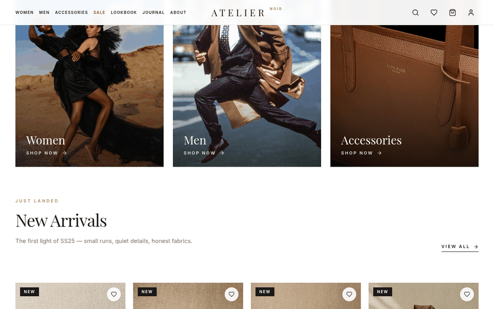
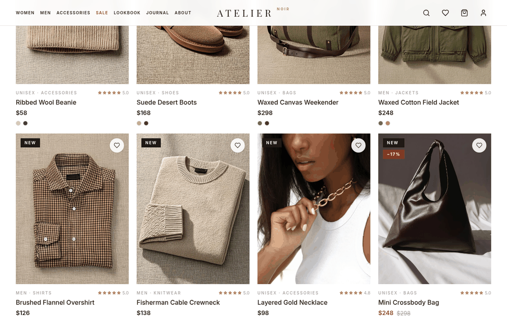

# Atelier Noir

**A modern storefront for a fashion clothing brand: editorial design, a full shopping flow from browsing to checkout, and user accounts.**

🔗 **Live demo:** [atelier-noir-roan.vercel.app](https://atelier-noir-roan.vercel.app)


## Features

**Shopping**
- Shop by collection (Women, Men, Accessories and more), with New Arrivals and Sale sections
- Product pages with image gallery, size selection and star ratings
- Customer reviews stored in the database
- Instant product search dialog
- Wishlist and a slide-out shopping bag

**Checkout & orders**
- Cart page plus a step-by-step checkout (Shipping → Payment → Confirmation)
- Payment options shown at checkout: Card, UPI and Cash on Delivery (demo checkout, no real payments are taken)
- Orders saved to the database

**Accounts**
- Register, log in and log out with cookie-based sessions
- Passwords hashed with scrypt
- Account page with recent activity

**Content & brand**
- Lookbook, Journal (blog posts), About, FAQ and Contact pages
- Editorial layout with a preloader, video media and smooth animations
- Fully responsive, from mobile to desktop

## Screenshots

<table>
  <tr>
    <td align="center"><br><sub>Collections & New Arrivals</sub></td>
    <td align="center"><br><sub>Product grid</sub></td>
  </tr>
  <tr>
    <td align="center" colspan="2"><br><sub>Mobile</sub></td>
  </tr>
</table>

## Tech stack

| Layer | Tools |
|---|---|
| Framework | Next.js 16 (App Router, API routes), React 19, TypeScript |
| Styling / UI | Tailwind CSS 4, shadcn/ui (Radix UI), Framer Motion, Lucide icons, Embla Carousel |
| State | Zustand, TanStack Query |
| Database | Prisma 6 ORM with SQLite |
| Hosting | Vercel |

**Data models:** User, Product, CartItem, Order, OrderItem, Review, Session, Activity.

## Getting started

```bash
git clone https://github.com/navpreet-dev/Atelier-Noir.git
cd Atelier-Noir
npm install            # also runs "prisma generate"
```

Create a `.env` file:

```env
DATABASE_URL="file:./dev.db"
```

Then set up the database and start the dev server:

```bash
npm run db:push
npx tsx prisma/seed.ts   # optional: seed sample products
npm run dev
```

Open [http://localhost:3000](http://localhost:3000).

### Scripts

| Command | What it does |
|---|---|
| `npm run dev` | Start the dev server on port 3000 |
| `npm run build` | Production build |
| `npm run start` | Run the production build |
| `npm run lint` | Lint with ESLint |
| `npm run db:push` | Push the Prisma schema to the database |
| `npm run db:generate` | Generate the Prisma client |
| `npm run db:migrate` | Create and apply a migration |
| `npm run db:reset` | Reset the database |

## How to use the site

1. **Browse** — pick Women, Men or Accessories from the menu, or use search.
2. **Open a product** — view photos, choose a size and read reviews.
3. **Save or add** — heart items for your wishlist or add them to the bag.
4. **Check out** — enter shipping details, choose a payment option and confirm.
5. **Create an account** — sign up to keep your orders and see your activity.
6. **Explore the brand** — read the Journal and flip through the Lookbook.

## Disclaimer

Atelier Noir is a portfolio project. Products are samples and no real payments are processed.

## Author

**Navpreet Singh**

- GitHub: [@navpreet-dev](https://github.com/navpreet-dev)
- LinkedIn: [navpreetsingh-dev](https://www.linkedin.com/in/navpreetsingh-dev)

If you like this project, a ⭐ on the repo is appreciated.
